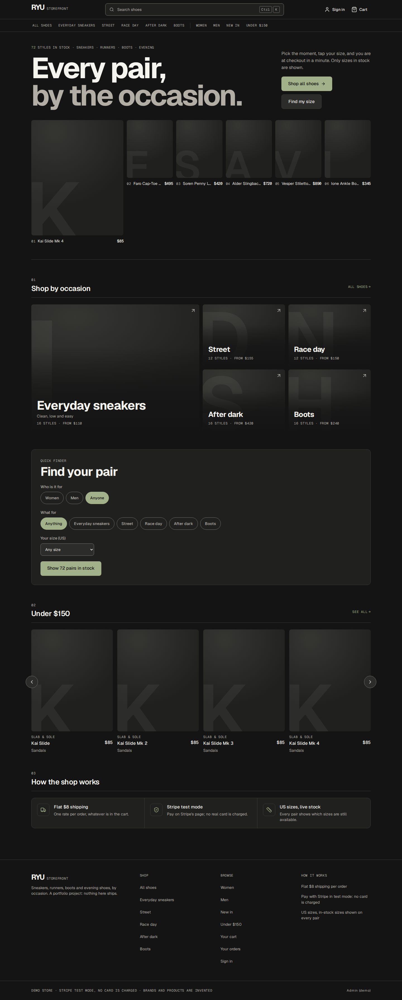
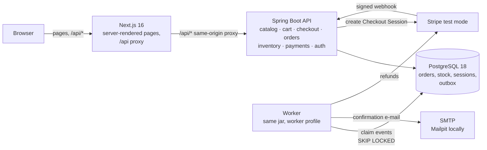

# RyuStoreFront

A footwear shop built to show how to handle the hard parts of e-commerce correctly: payments that arrive twice or out of order,
stock that many buyers want at once, an order lifecycle with enforced rules, and background work that survives a crash.
Java 25 and Spring Boot 4 with PostgreSQL, a Next.js frontend, and Terraform for AWS.

**This is a demo store.** Products, brands and descriptions are invented, and payments run in Stripe **test mode** only (card `4242 4242 4242 4242`).



## What it demonstrates

| Problem | How it is handled | Proof |
| --- | --- | --- |
| **Payment idempotency.** Stripe retries webhooks and can send them in any order | The signature is checked on the raw request bytes. The event id is inserted first (`ON CONFLICT DO NOTHING`), with one transaction per event and the order row locked. A payment that arrives late or for the wrong amount is refunded automatically, once | The same event sent 3 times in sequence and 6 times at once leaves **1 paid order, 1 payment, 1 e-mail**. Out-of-order expired/completed pairs are tested (`StripeWebhookTests`, 19 tests) |
| **No overselling** | An atomic `UPDATE ... WHERE stock >= n` plus a reservation row with an expiry, backed by `CHECK (stock >= 0)` | **50 concurrent buyers for 10 units → exactly 10 reservations, in each of 20 rounds** (real Postgres in Testcontainers) |
| **Order state machine** | One transition table (`pending → paid → fulfilled → shipped`, plus `cancelled` and `refunded`). Every change goes through one locked method that writes history and an event | **All 36 status pairs** are tested. Concurrent identical transitions apply once |
| **Transactional outbox and worker** | Events are written in the same transaction as the change and drained with `FOR UPDATE SKIP LOCKED`, with retry, backoff and a dead state. Handlers are idempotent | A worker **killed with SIGKILL mid-job** finishes the job exactly once after restart (`WorkerKillTests`) |
| **Module boundaries** | A modular monolith (`catalog`, `cart`, `checkout`, `orders`, `inventory`, `payments`, `auth`, `outbox`, `notifications`, `worker`) with the boundaries checked by Spring Modulith | `ModularityTests` |
| **Query performance** | Indexes chosen from `EXPLAIN`, plus a maintained `min_price_minor` column for price sort and count | At 50,000 products / 750,680 variants (local, single runs): count **518 → 22 ms**, price sort **227 → 20 ms** (`docs/explain/`) |
| **Cloud deployment** | Terraform in two stages: a kept `foundation` (DNS zone, registry, certificate, secrets) and a 31-resource `session` stage destroyed after each run | One real test-mode checkout on Fargate behind an HTTPS ALB with RDS. Destroyed afterwards, and a **13-check audit came back clean** |

Every number above has a row, with its setup and status, in [`docs/metrics.md`](docs/metrics.md).

## Architecture



- **One jar, two roles.** The API and the worker are the same image; the `worker` profile turns on the outbox drain and the expiry sweep.
- **Same-origin API.** The browser only talks to the Next.js app, which proxies `/api/*`. Session and cart cookies stay first-party
  (HttpOnly, SameSite=Lax), so no CORS is needed.
- **Hosted Stripe Checkout.** Card data never touches these servers. An order becomes `paid` only through the verified webhook,
  never because the shopper reached the return page.
- **In AWS:** Fargate behind an ALB with an ACM certificate, RDS Postgres single-AZ, Secrets Manager, CloudWatch, Route 53 for
  `api.ryustorefront.com`. No NAT gateway: tasks sit in public subnets, with security groups as the only barrier (said plainly in `docs/decisions.md`).

## Quick start (local)

Needs Docker, JDK 25 and `jq`. Node runs inside Docker through `scripts/web.sh`, so no Node install is needed.

```
cp .env.example .env                     # set POSTGRES_PASSWORD; Stripe keys are optional
docker compose up -d                     # Postgres 18.7 and Mailpit (inbox at http://localhost:8025)
set -a; . ./.env; set +a

# terminal 1: the API with 100 demo products
SPRING_PROFILES_ACTIVE=seed STOREFRONT_SEED_PRODUCTS=100 ./mvnw spring-boot:run

# terminal 2: the worker (e-mails, cart clearing, expired reservations)
SPRING_PROFILES_ACTIVE=worker SERVER_PORT=8081 ./mvnw spring-boot:run

# terminal 3: the frontend on http://localhost:3000
scripts/web.sh npm install
API_ORIGIN=http://localhost:8080 scripts/web.sh npm run dev
```

To pay locally, put a Stripe **test** key in `.env` as `STRIPE_SECRET_KEY`, run `stripe listen --forward-to localhost:8080/api/stripe/webhook`,
put the `whsec_...` it prints in `.env` as `STRIPE_WEBHOOK_SECRET`, and restart the API. Without a key the shop still runs, and "Pay" answers 503.

## Tests

| Suite | Command | Last result |
| --- | --- | --- |
| Backend: unit, integration (real Postgres and Mailpit in Testcontainers), concurrency, webhook, worker-kill | `./mvnw -B verify` | 241 tests, 0 failures (2026-11-15, user-reported) |
| Screens: every page and state at 1440 and 390 px, with an axe scan (against a mock API) | `scripts/design-shots.sh` | 119 pages, 0 axe violations, Chromium only (2026-11-15, run) |
| Live: catalogue, auth, cart, checkout against the real API | start the API, then `scripts/web-live-check.sh` | 17 tests in `web/live/` |

CI runs `./mvnw -B verify` on every pull request. The frontend checks are not in CI yet.

## Evidence

Statuses: **Run** (output seen by the author's tooling), **User-reported** (run by the owner, output pasted), **Documented**, **Not run**.

| Claim | Status | Where |
| --- | --- | --- |
| 241 backend tests, 0 failures | User-reported (raw reports read) | `docs/metrics.md` B1 |
| Duplicate and concurrent webhooks → one paid order | Run | B2 |
| 50 buyers / 10 units → exactly 10, 20 rounds | User-reported | B3 |
| Worker killed mid-job completes once | User-reported | B5 |
| 36 order status pairs tested | User-reported | B6 |
| 119 pages, 0 axe violations | Run | F1 |
| Count 518 → 22 ms, price sort 227 → 20 ms (local, single runs) | User-reported | D1, D2 |
| One real checkout on AWS; 31-resource session destroyed; 13-check audit clean | User-reported | C1–C3 |
| Lighthouse, page weight, k6 latency, cloud cost, cloud webhook replay | Not run | F3–F5, P2, C7–C9 |

The dated log behind these is [`docs/verification.md`](docs/verification.md).

## Not done (by choice or not yet)

- **Out of scope:** real payments, tax and shipping-rate engines (flat $8 shipping), multiple currencies, multi-vendor, recommendations, a mobile app, microservices.
- **Not built yet:** order history and the admin area show **demo fixtures**, because the API has no order-list or admin endpoints.
  Product photos are placeholders until the licensed-image pipeline lands. The frontend and the worker have not run in AWS yet.
- **Not measured yet:** Lighthouse, page weight, API latency under load, real cloud cost (see `docs/metrics.md`).
- **Security limits:** no login rate limiting or lockout, no password reset or e-mail verification, and the database TLS check is
  `sslmode=require`, not `verify-full`.

## Documentation

| Topic | File |
| --- | --- |
| Every decision, with its tradeoff | [`docs/decisions.md`](docs/decisions.md) |
| Numbers ledger | [`docs/metrics.md`](docs/metrics.md) |
| Dated verification log | [`docs/verification.md`](docs/verification.md) |
| Payments and the webhook | [`docs/payments.md`](docs/payments.md) |
| Order lifecycle | [`docs/order-lifecycle.md`](docs/order-lifecycle.md) |
| Outbox and worker | [`docs/worker.md`](docs/worker.md), [`docs/email.md`](docs/email.md) |
| API contracts | [`docs/api/`](docs/api/) |
| Query plans | [`docs/explain/`](docs/explain/) |
| AWS: rebuild from zero, sessions, teardown, audit | [`infra/README.md`](infra/README.md) |
| Design brief and review | [`design/`](design/) |
| Frontend | [`web/README.md`](web/README.md) |

## Image credits

There are no photographs in the store yet; product images are typographic placeholders. When photos are added, each will come from
CC0, public-domain, Pexels-licence or Pixabay-licence sources, with its author, source and licence listed on the store's
Image credits page and in the image manifest.
