# Design proposal (phase 2, 2026-11-20)

The redesign of four key screens, built in the app on this branch, in your portfolio tones: dark, high contrast, one sage
accent, Geist and Geist Mono (self-hosted). Screenshots are real Playwright captures of the production build against the
**mock API** at 390, 820 and 1440 px. **Product photos are not in yet** (phase 4): every grey frame with a large letter is
where a photograph goes, so judge layout, type, colour and rhythm, not imagery. The photos are meant to carry the colour.

To approve: the visual direction, the shortlist in [`COMPONENT-NOTES.md`](COMPONENT-NOTES.md) (which spends your paid
`get_component` quota, 9 retrievals for the first choices), and the open questions at the end.

## What changed everywhere

- **Tokens** (`web/src/styles/tokens.css`): your palette as given. Two additions, both for accessibility: `line-control`
  `#7A7872` for input, chip and outline borders (your `#5A5955` is 2.6:1, below the 3:1 that WCAG 1.4.11 asks of control
  boundaries), and `on-accent` `#141414` for labels on sage and amber.
- **Type:** Geist for UI and headings (bold, tight tracking, a 104 px hero on desktop); Geist Mono, uppercase, for labels,
  breadcrumbs, counts, the category bar and prices.
- **Shape:** squarer radii (4/8/12 px), no shadows except overlays, no gradients except a dark scrim under text on images.
- **Motion:** 120/180/240 ms, opacity and transform only, all removed under `prefers-reduced-motion` (existing global rule).

### Contrast (computed, WCAG 2.x)

| Foreground | on `#141414` bg | on `#20201F` surface 1 | on `#2C2C2A` surface 2 |
| --- | --- | --- | --- |
| Text `#ECEAE4` | 15.31 | 13.55 | 11.63 |
| Muted `#B2AEA6` | 8.33 | 7.38 | 6.33 |
| Subtle `#8F8C84` | 5.48 | 4.86 | **4.17 (fails 4.5; not used here)** |
| Sage `#A3B18A` (links, focus ring) | 8.08 | 7.15 | 6.14 |
| Amber `#D4A65A` | 8.25 | 7.30 | 6.26 |
| Control border `#7A7872` (needs 3:1) | 4.17 | 3.69 | 3.17 |
| `#141414` label on sage / sage hover / amber | 8.08 / 10.02 / 8.25 | | |

All 12 px caption text that used `subtle` now uses `muted`, following your "subtle only at 14 px or larger" rule.

## Screens

### Home

| 390 | 820 | 1440 |
| --- | --- | --- |
| 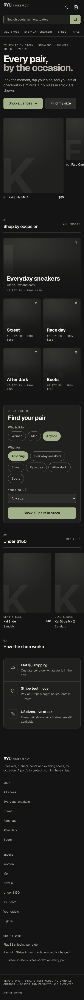 | 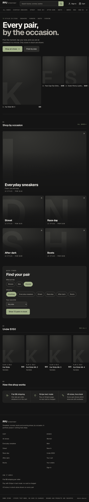 | 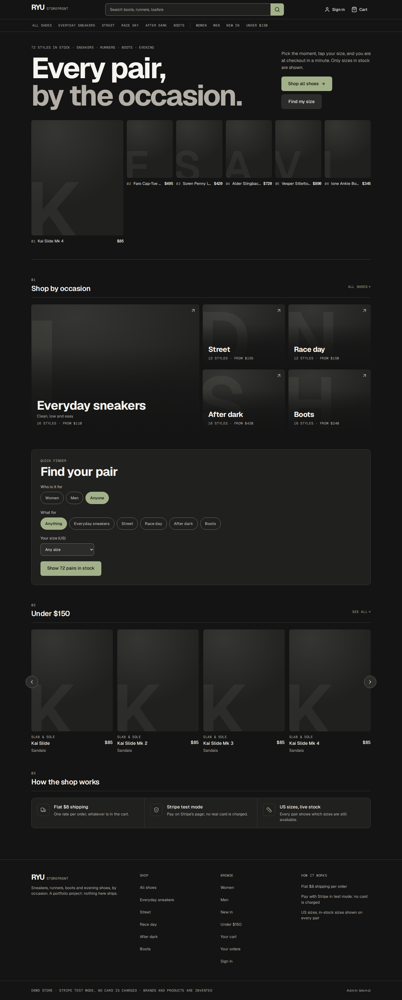 |

Before: a quick-finder hero beside a headline, equal category tiles, two product rows ([old home](screens/home-desktop.png)).
After: an oversized two-line headline with a mono in-stock count, then a **filmstrip** of the six newest pairs (lead frame large,
the rest share its top edge; it swipes on phones). **Shop by occasion** is an image grid with a 2×2 lead tile, counts and
"from" prices in mono. The quick finder moves below as its own panel. Sections are numbered (01, 02, 03) in mono.

### Product listing

| 390 | 820 | 1440 |
| --- | --- | --- |
| 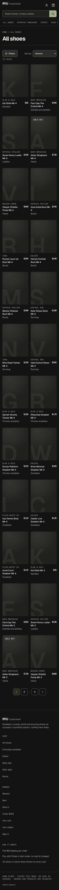 | 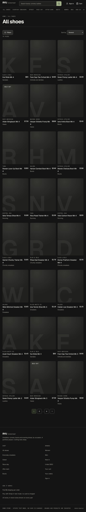 | 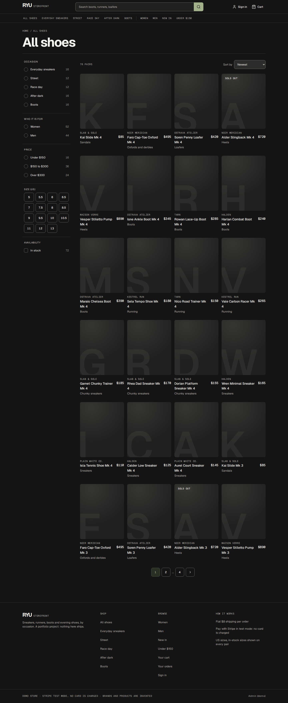 |

Same structure and filters (they work as before); a display-size title, a mono breadcrumb and count, and the new card: brand
in mono, price in mono, and a second view that fades in on hover or keyboard focus.

### Product page

| 390 | 820 | 1440 |
| --- | --- | --- |
| 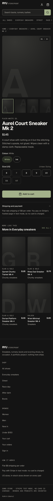 | 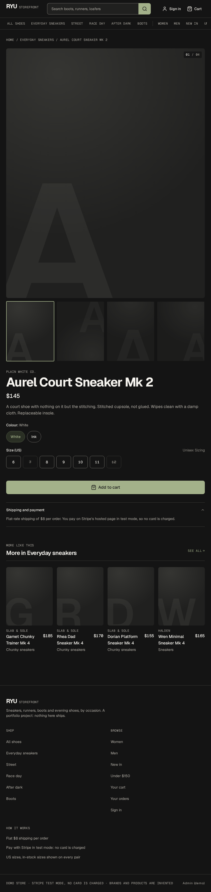 | 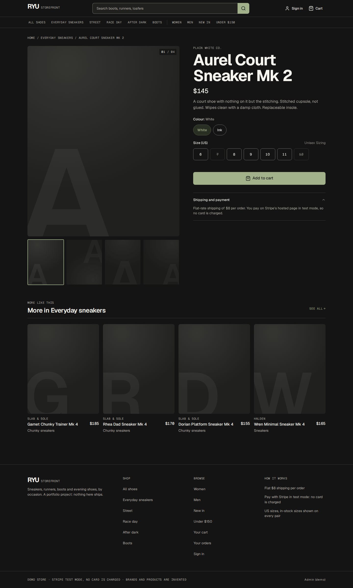 |

Gallery with a `01 / 04` counter, thumbnails below, Left/Right arrows move between views; display-size name; mono price.
The colour and size pickers are unchanged in behaviour.

### Sign in and create account

| | 390 | 820 | 1440 |
| --- | --- | --- | --- |
| Sign in | 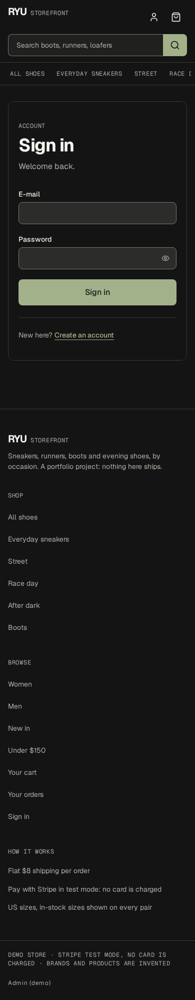 | 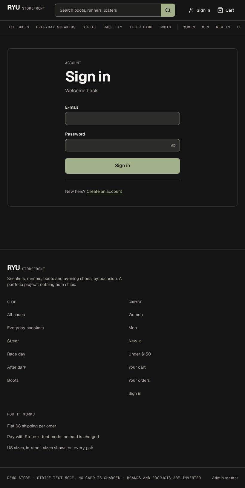 | 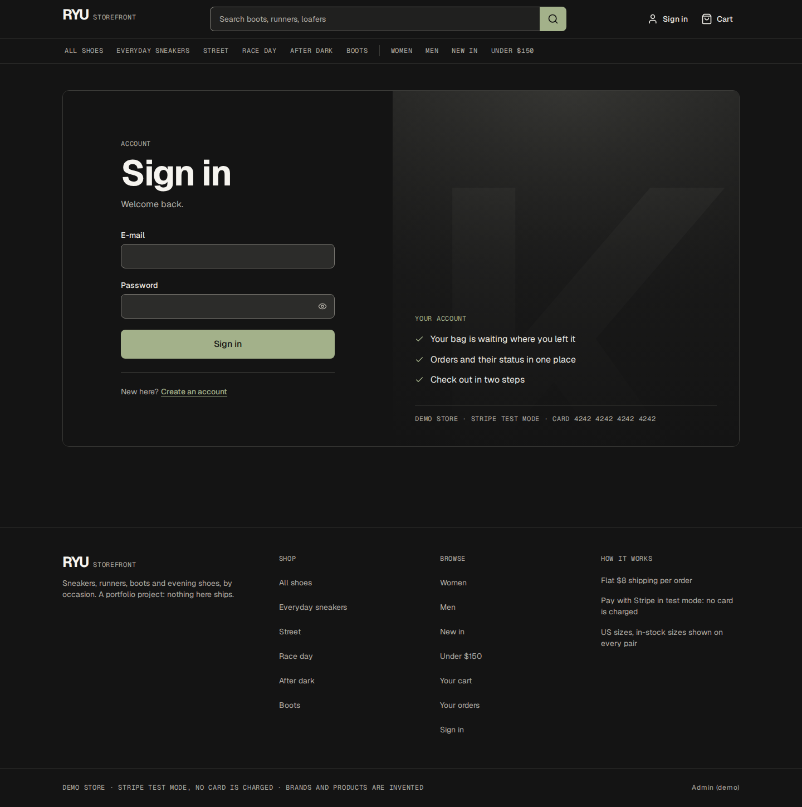 |
| Create account | 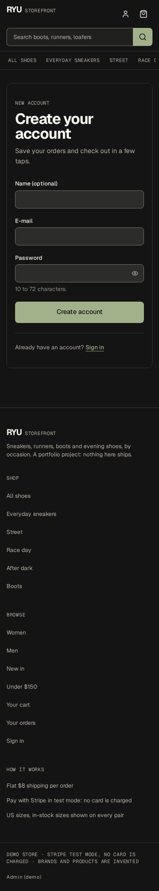 | 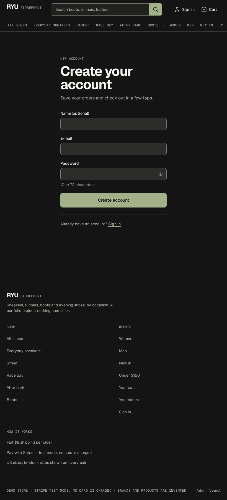 | 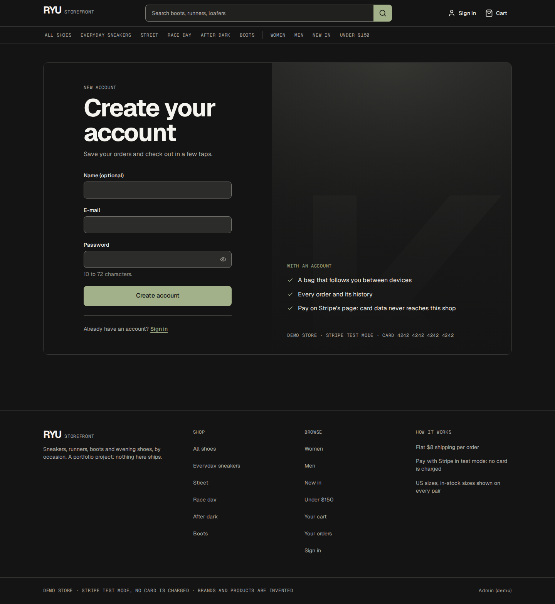 |

Split screen on desktop: the form on the left (display heading, show/hide password), and a panel on the right with a catalogue
product and three true statements about the account, ending with the demo and test-card line. No testimonial and no
"Continue with Google": there are no customers to quote and the API has no social sign-in. On phones and tablets the panel is
hidden so the form comes first.

## Checks run on these screens

- axe (WCAG 2.0/2.1 A and AA, Chromium): **15 page-widths, 0 violations** (`docs/metrics.md` F7).
- Horizontal overflow at 390, 820 and 1440 px: **0 px** on all 15. Not yet checked at 320 px (phase 3 adds that test).
- Lighthouse "before" numbers of the current design are recorded (`docs/metrics.md` F3, F4) so the redesign can be compared
  after it is built. Not measured for the proposal yet.

## Things to look at

1. Is the hero headline bold enough, or do you want it even larger, or a single line?
2. The filmstrip on desktop leaves space under the five small frames; the alternative is all six the same height (calmer, less distinctive).
3. Sage for selected chips and the primary button: solid sage with a dark label (as shown) or an outlined sage?
4. The header search becomes the command palette (⌘K) once the component is retrieved; today it is still the plain field.

## Known gaps in these screens (not hidden)

- **No photographs** (phase 4). Grey frames with letters are placeholders.
- The "Under $150" row repeats one product four times: the mock API clones its 19 fixture products four times. The real API does not.
- Product names truncate under the five small filmstrip frames on desktop.
- None of the 21st.dev code is in yet; each slot follows its shortlisted pattern, written here.
- Not built in this batch: cart drawer, checkout stepper, command palette, zoom, and the restyle of cart, checkout, orders and admin
  (they pick up the new tokens automatically but were not reviewed). The `/design` token page still lists the old colours.
- Not checked: real devices, Firefox and WebKit, keyboard-only walkthrough, screen reader, 320 px.
