# Phase 3 review: the redesign, built (2026-11-20)

The approved proposal ([`PROPOSAL.md`](PROPOSAL.md)) built out, with the 21st.dev components adapted
([`COMPONENT-NOTES.md`](COMPONENT-NOTES.md)). Screenshots are Playwright captures of the production build against the
**mock API**, at 390, 820 and 1440 px. **No product photos yet** (phase 4): grey frames with a letter are placeholders.

## New since the proposal

| | 390 | 820 | 1440 |
| --- | --- | --- | --- |
| Search palette (Ctrl/Cmd+K or "/") | 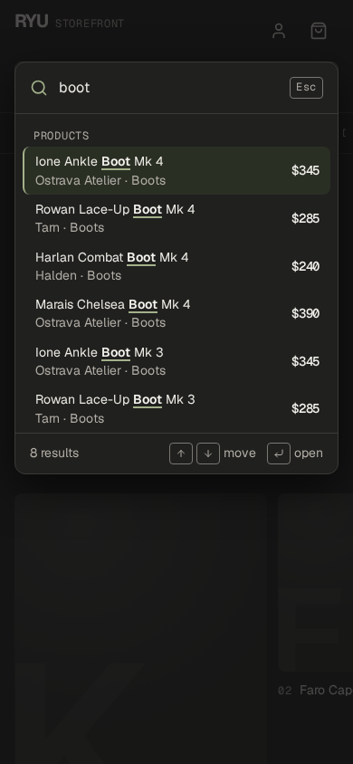 | 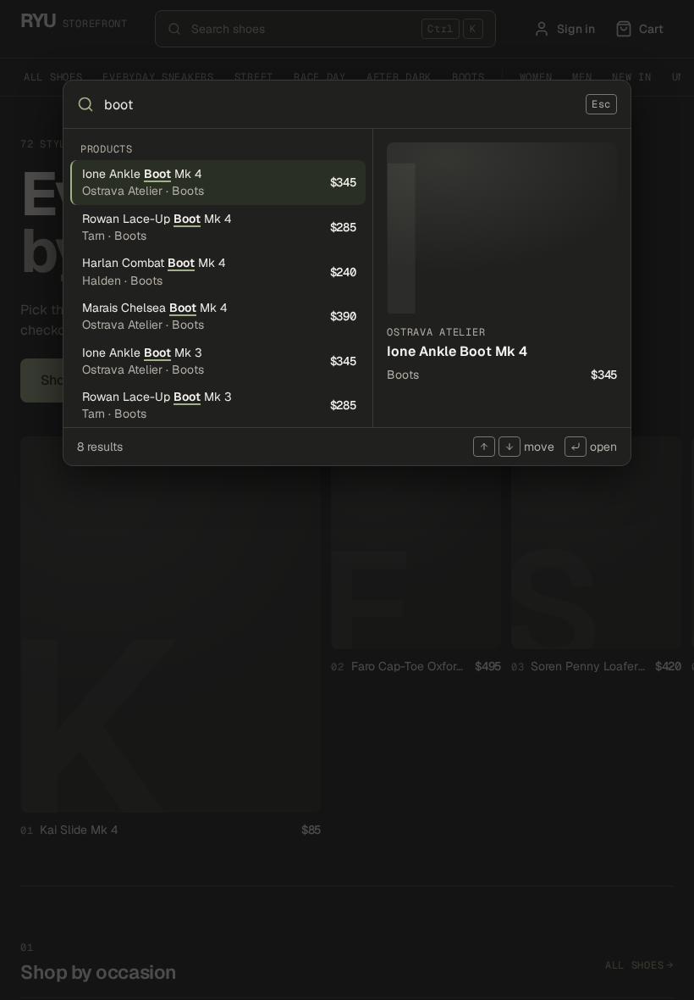 | 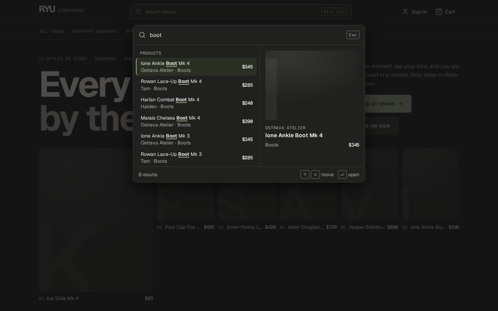 |
| Cart drawer (after "Add to cart") | 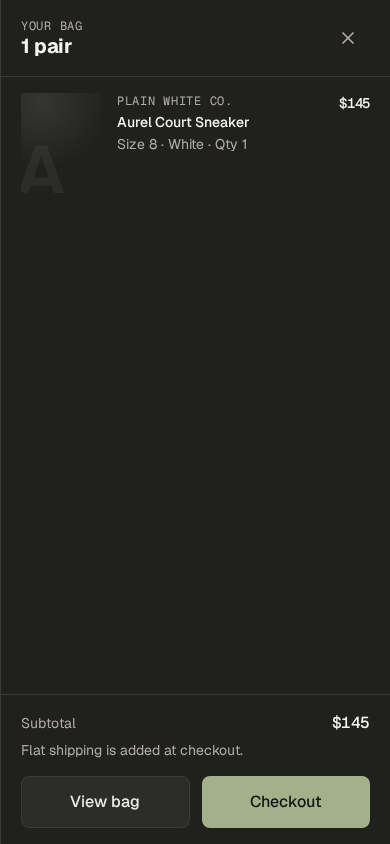 | 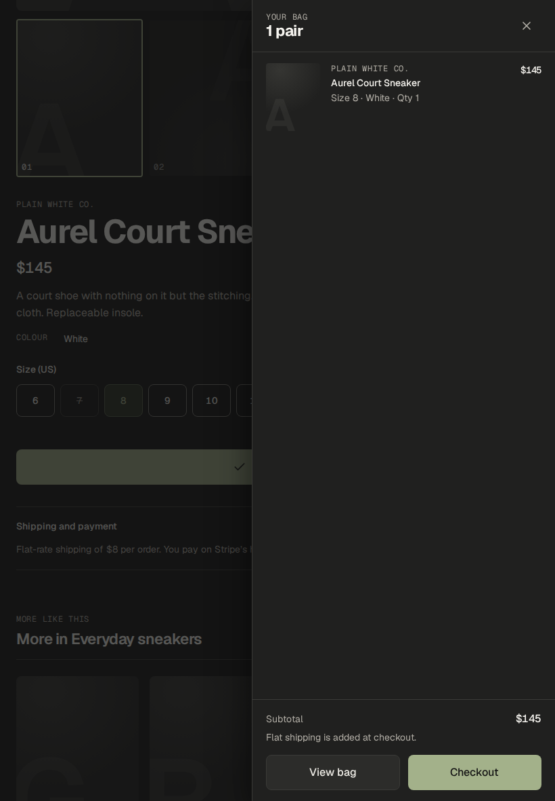 | 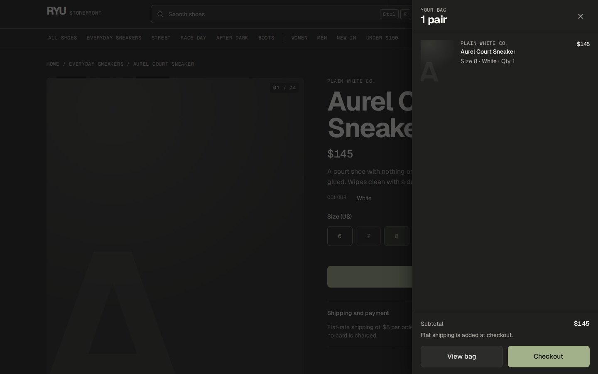 |
| Checkout stepper | 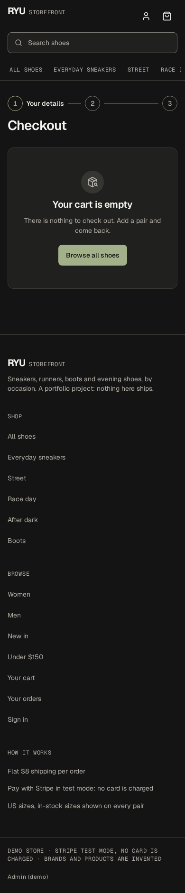 | 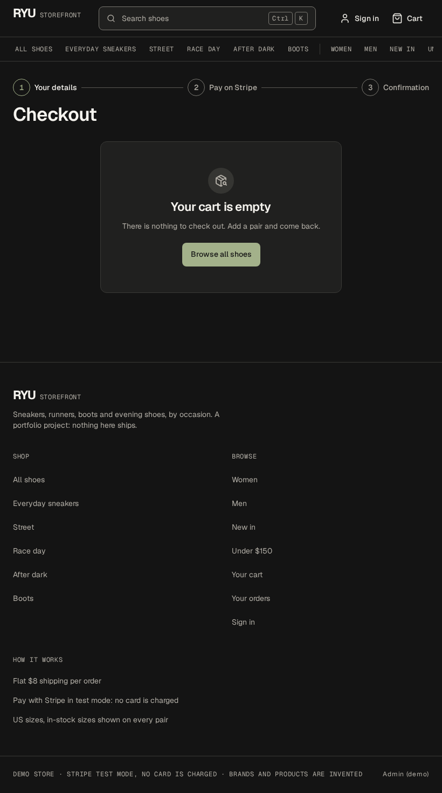 | 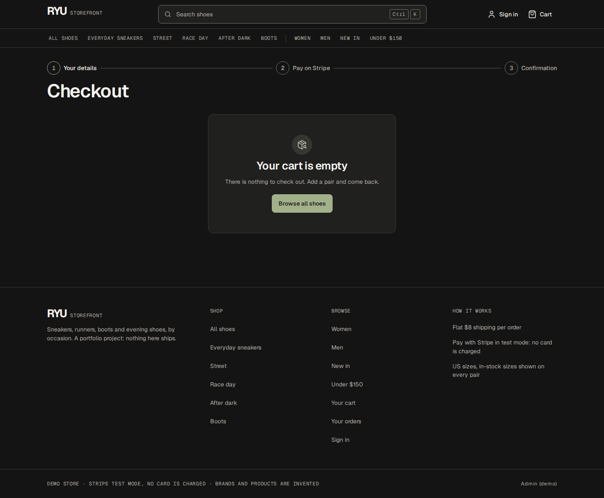 |

- **Search palette** (from vovalopuh13's Command Palette): real product results from the API as you type, matched letters
  underlined in sage, a preview pane with the product, occasions and quick links, and a "Search all shoes for …" row.
  Keyboard: arrows, Home/End, Enter, Escape. It replaces the header search field.
- **Cart drawer** (from ddoemonn's Drawer): opens after "Add to cart" instead of the toast; focus goes in, Tab stays in,
  Escape or the scrim closes it, focus returns to the button. The header "Cart" is still a link to the cart page.
- **Stepper** (from kevingirelli's Stepper): checked circles for done steps, the current step outlined, a filled line between
  done steps; on phones only the current step's title shows, the others are read to screen readers.

## The four approved screens, as built

| | 390 | 820 | 1440 |
| --- | --- | --- | --- |
| Home | 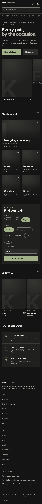 | 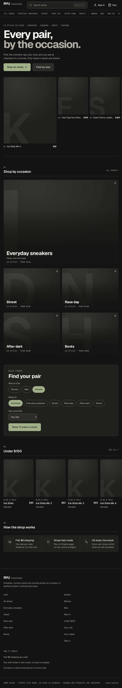 | 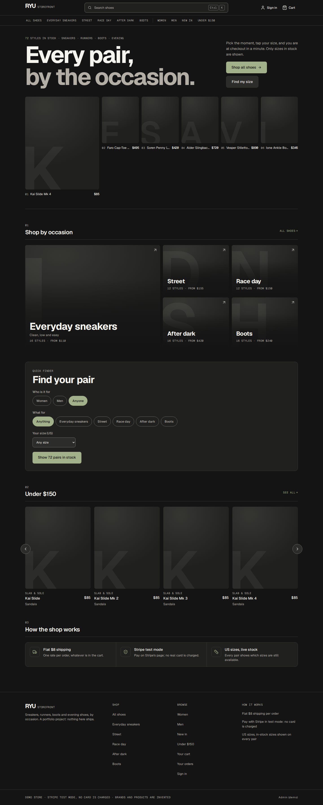 |
| Listing | 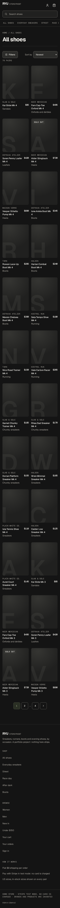 | 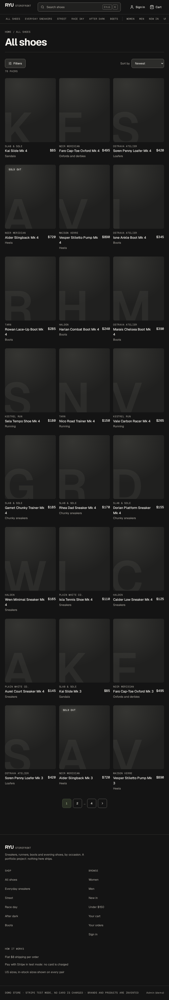 | 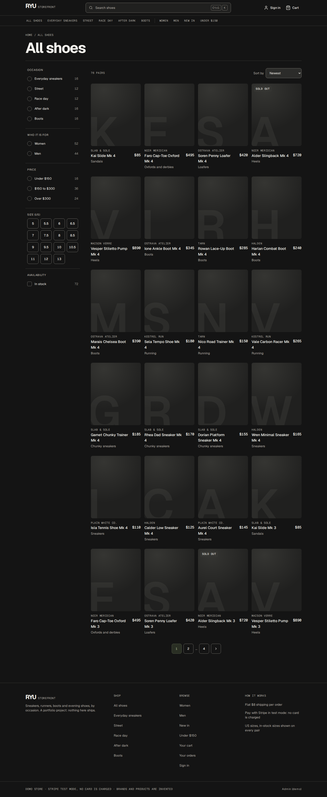 |
| Product | 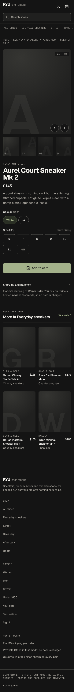 | 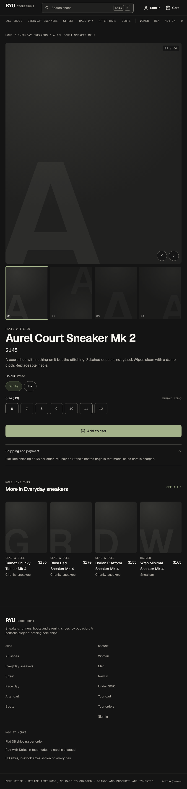 | 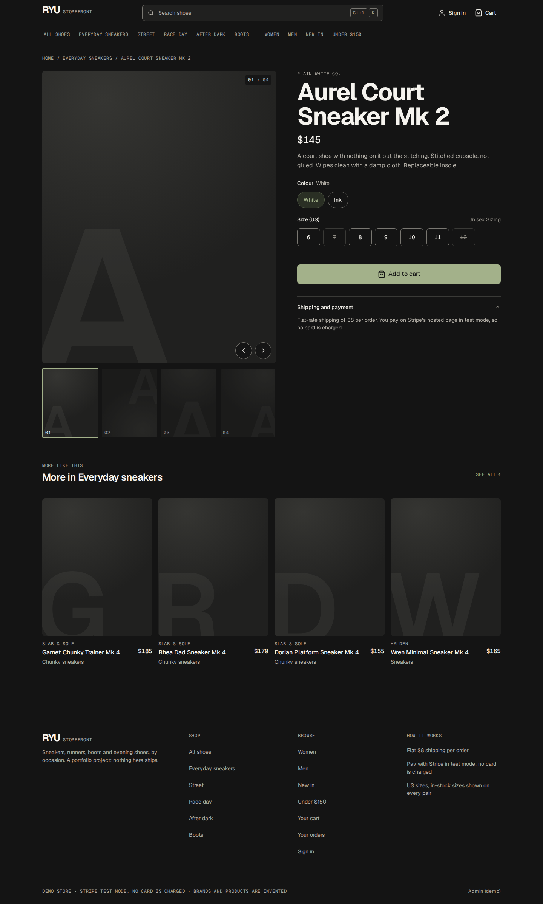 |
| Sign in | 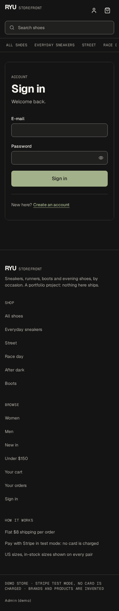 | 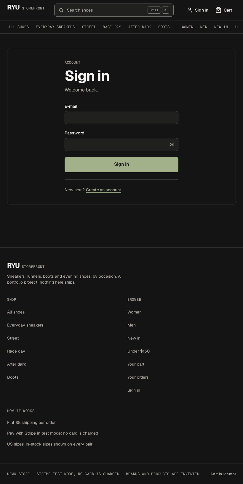 | 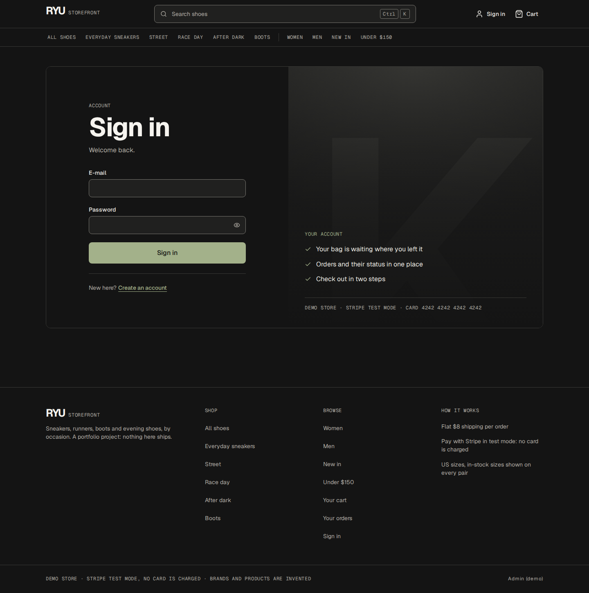 |
| Create account | 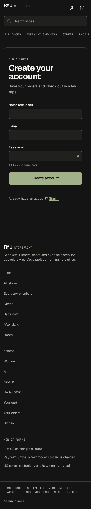 | 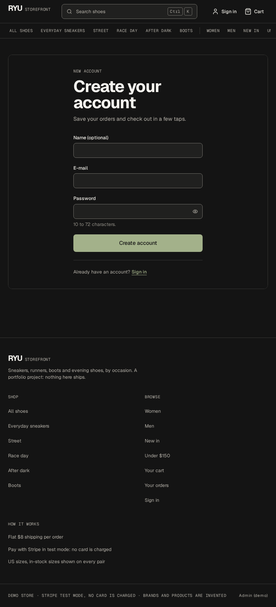 | 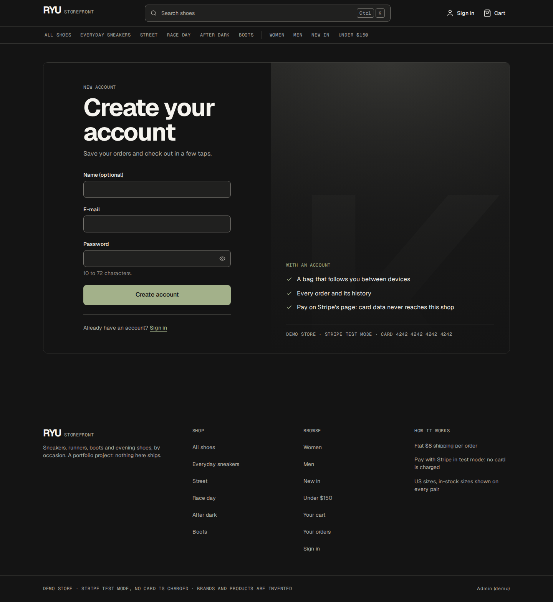 |

Before/after against the proposal: the product gallery gained previous/next buttons and numbered thumbnails (proper tabs for
screen readers); the header search became the palette trigger with a key hint; everything else is as approved.

## Bugs the new tests found and fixed

1. **Focus was lost after "Add to cart"** (older than this phase): the button was `disabled` while the request ran, which drops
   keyboard focus to the page. Now `aria-disabled` with a double-submit guard.
2. **Gallery thumbnails failed axe `label-content-name-mismatch`** at 320 px: the accessible name did not contain the visible
   "01". The name is now "View 01 of 04".
3. **Admin filter counts failed colour contrast** (`fg-subtle` on the sage tint, 4.09:1). Now `fg-muted` (6.21:1). Input
   placeholders moved off surface-2 for the same reason.
4. **Listing heading order** (Lighthouse "before" run): `h1` then `h3` cards. Hidden `h2`s added for the filters and results.
5. **Missing favicon** (a console error on every page in the "before" run): `app/icon.svg` added.
6. **Fonts were 138 KB** (Lighthouse "after" run): the `geist` npm package ships the full variable fonts. Switched to
   Next's font loader, which subsets Geist and Geist Mono to Latin at build time and still serves them from this site.
   Fonts 138.0 KB → 51.8 KB; home page on mobile 345.7 KB → 260.6 KB transferred (`docs/metrics.md` F8).

## Performance: what the numbers say (and what they cannot)

The first "after" run looked like a big mobile regression (performance 85–92 → 72–77). Re-measuring the **old code** in the
same session gave 72–79, so most of that drop was this VM drifting between sessions, not the redesign. Back to back
(`docs/metrics.md` F3b, F3c), mobile performance is: home 74 → 72, listing 72 → 71, product 73 → 74, sign-in 79 → 74;
accessibility is now 100 everywhere (listing was 98). Bytes do not drift: JS +5 KB per page, total +31 to +33 KB (the
second font). Sign-in may really be a little slower; three simulated runs per side cannot show it. Phase 5 uses more runs,
interleaved, before claiming anything.

## Things to look at

1. The cart drawer replaces the "Added" toast. Is that the behaviour you want on every add, or only the first?
2. "/" opens search when you are not typing in a field. Keep it, or Ctrl/Cmd+K only?
3. Without JavaScript the header has no search now (the listing and filters still work).

## Not checked

- Real devices, Firefox and WebKit (Chromium only), a screen reader, real product photos (phase 4).
- The live API checks (`scripts/web-live-check.sh`) were **not run** in this phase; two of them were adjusted (exact
  "Password" label, the "New in" list is now the hero filmstrip). Please run them against your API.
- Cart, orders and admin pages pick up the new tokens and pass axe, but were not redesigned beyond that.
