# Review gallery: layout and motion revision

Branch `design/layout-and-calm-motion`, 2026-11-15. Screenshots are Chromium at 1440 px and 390 px wide, made by `scripts/design-shots.sh` from the production build; the axe scan found 0 violations on all 33 pages. **Owner sign-off: not done.** What was not checked is listed at the end.

What changed everywhere: two-tier header and a four-column footer on every page; one container width and one section heading style; minimal motion (colour and opacity only, no scroll-reveal, shared-layout, exit or hover-zoom animations, no shimmer, toast by CSS, the `motion` dependency removed). Reasons and trade-offs are in [docs/decisions.md](../docs/decisions.md).

## Home

Before: bespoke uneven occasion grid (one large tile spanning two rows), a single-tier sticky header with a menu dialog, one product row, scroll-reveal animations. After: two-tier header, hero with the finder card kept, five equal tiles, two product rows (New in, Under $150), a value strip of three true statements, a four-column footer.

| Before (desktop) | After (desktop) |
| --- | --- |
|  |  |

| Before (phone) | After (phone) |
| --- | --- |
| 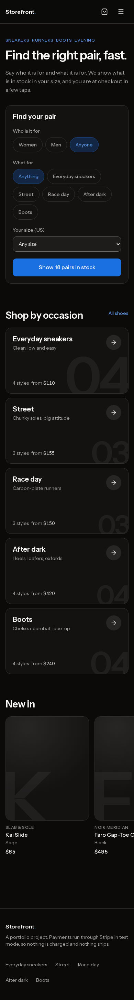 |  |

## Listing

Before: three rows of filter chips and a collapsible size panel above the grid, no counts. After: filter sidebar on desktop with a count beside every option, active-filter pills with "Clear all", sort at the top right, four-column grid.

| Before (desktop) | After (desktop) |
| --- | --- |
| 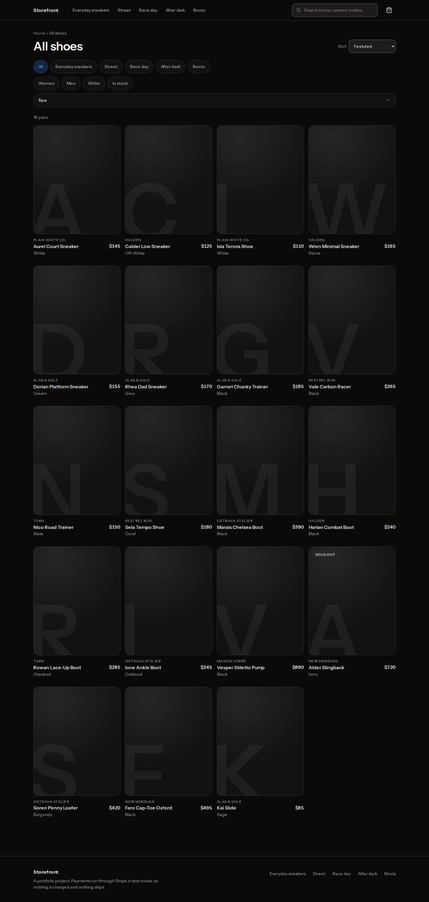 | 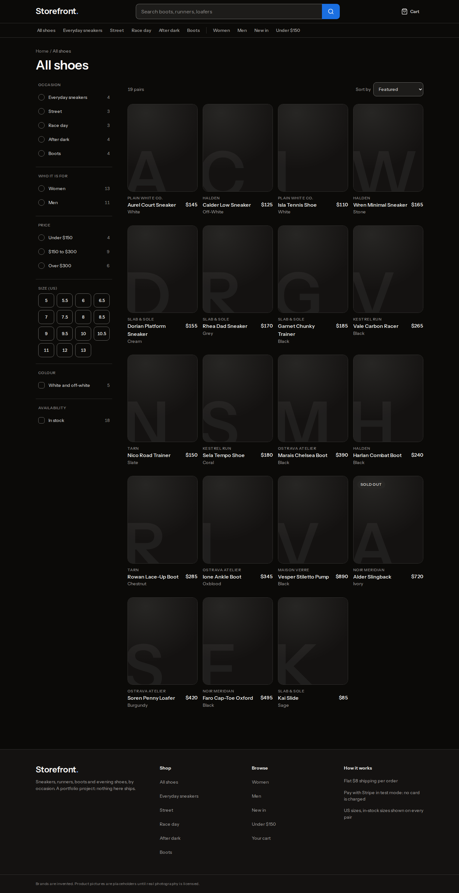 |

| Before (phone) | After (phone) |
| --- | --- |
| 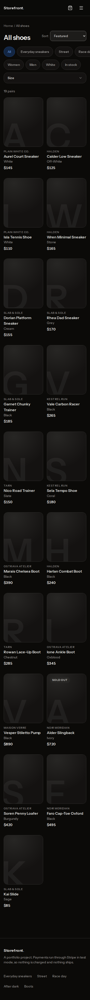 |  |

## Product page

Before: own container and heading sizes, animated image cross-fade and a sliding size-selection indicator. After: same content on the shared container and section heading ("More in ..." uses the shared `Section`), no animation; selected size is a filled state.

| Before (desktop) | After (desktop) |
| --- | --- |
|  |  |

| Before (phone) | After (phone) |
| --- | --- |
| 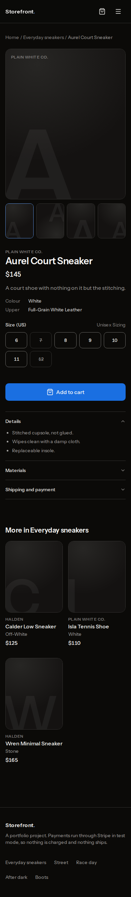 | 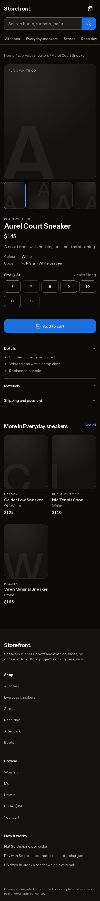 |

## Cart

Before: lines animated in and out. After: same content and layout on the shared container, header and footer; lines change instantly.

| Before (desktop) | After (desktop) |
| --- | --- |
| 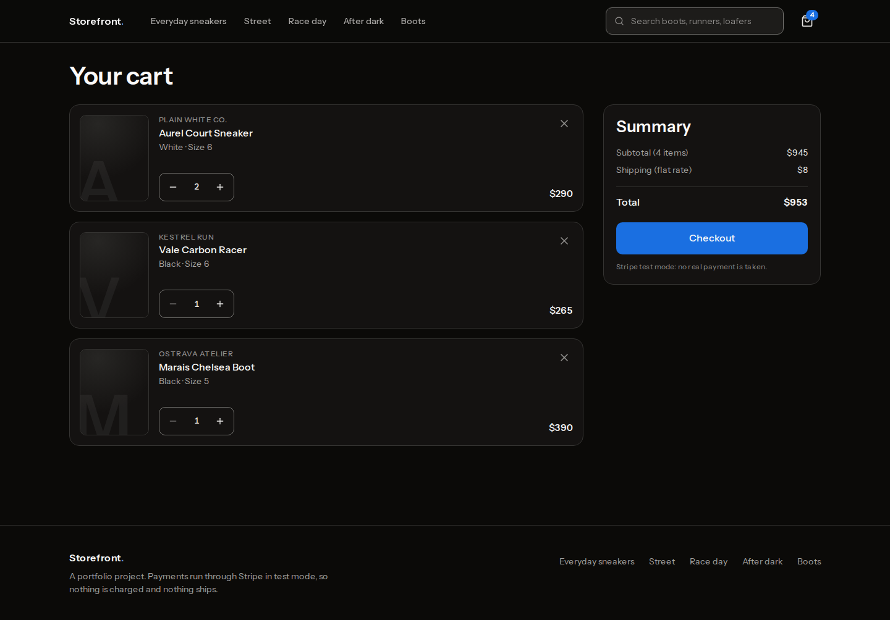 | 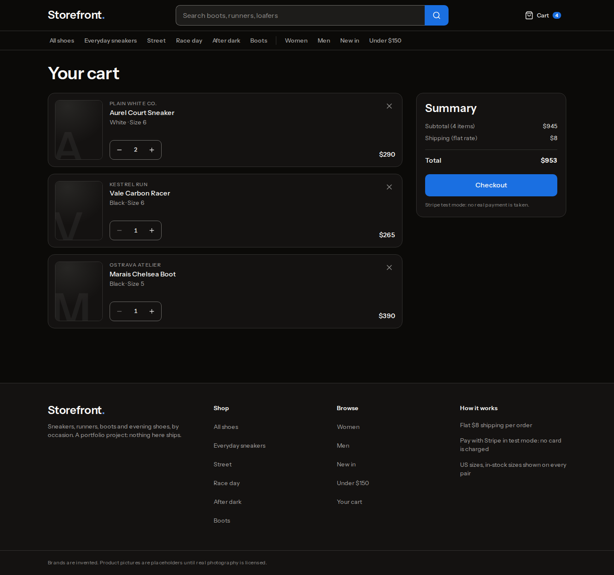 |

| Before (phone) | After (phone) |
| --- | --- |
|  |  |

## New and changed states (no before)

| Screen | Desktop | Phone |
| --- | --- | --- |
| Listing, filtered (After dark, women) | 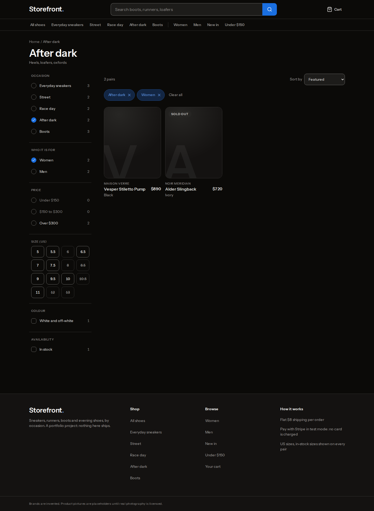 |  |
| Listing, price band plus in stock | 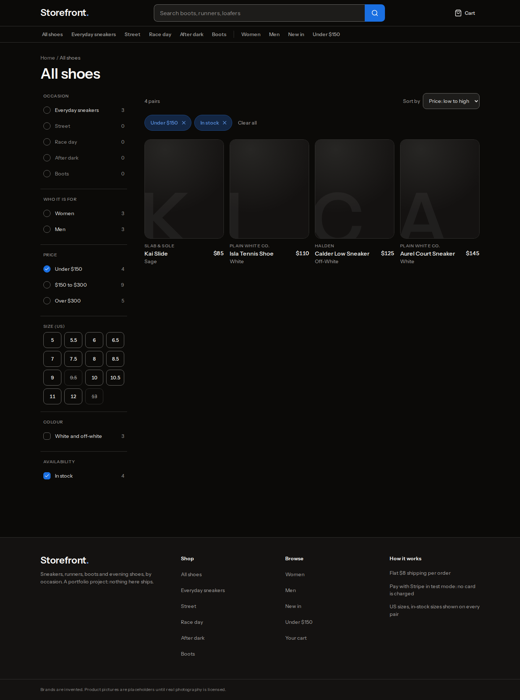 |  |
| Listing, phone filter drawer | | 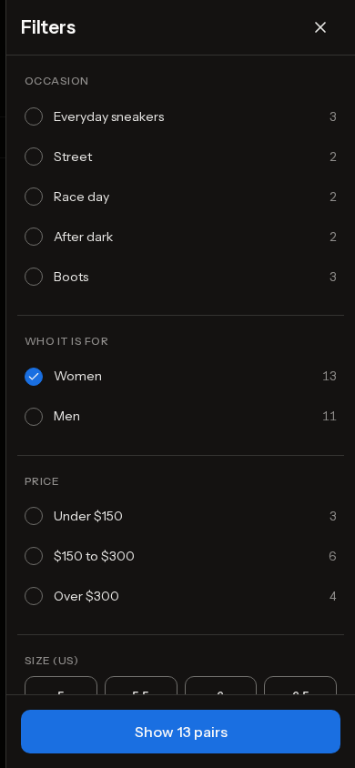 |
| Listing, loading |  | 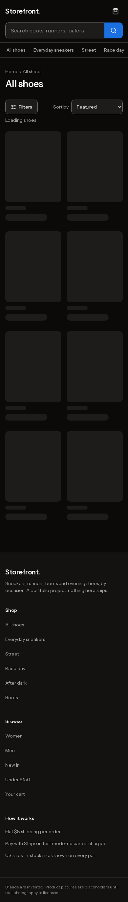 |
| Listing, empty |  | 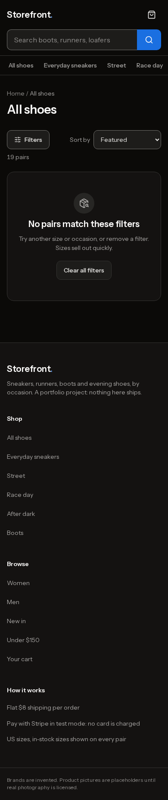 |
| Listing, error |  |  |
| Product, sold out |  | 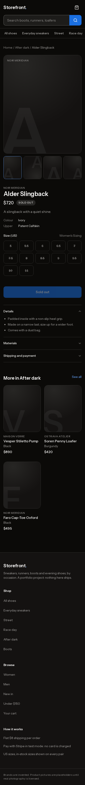 |
| Product, after add to cart |  |  |
| Cart, empty |  |  |
| Cart, loading | 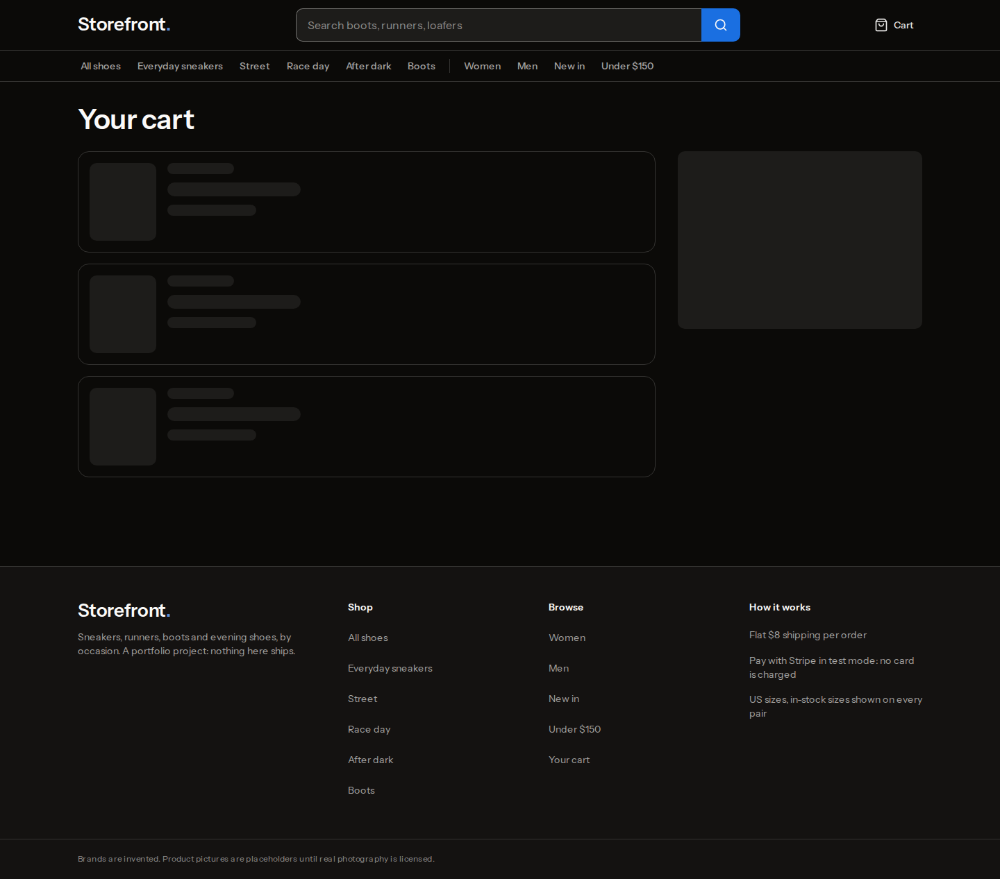 | 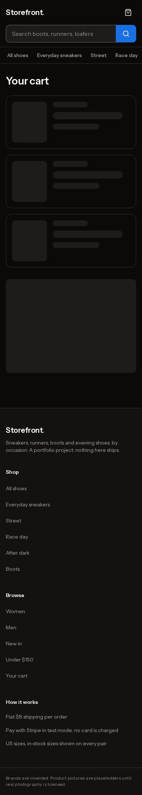 |
| Cart, error | 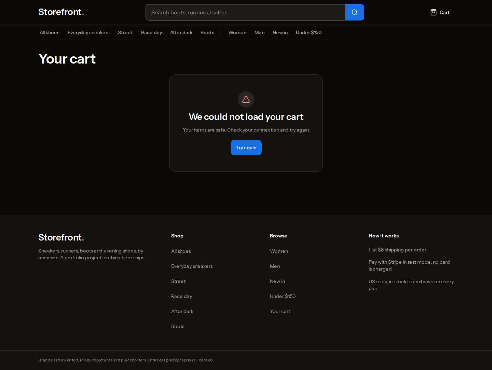 |  |
| Design system page |  | 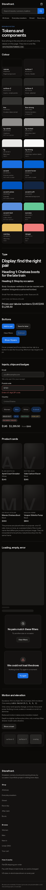 |
| Not found |  |  |

## Things to look at

- The five category tiles use the first product of each category as their picture; the placeholders are still typographic.
- Kai Slide (sandals) belongs to no occasion, so it appears only under "All shoes" and the price filters. Decide whether sandals need a tile.
- The header is not sticky. Say if you want it to stay on screen.
- The phone category tile row ends with one full-width tile (five tiles in two columns).

## Not checked

Real devices; Firefox and WebKit; keyboard-only and screen-reader walkthroughs; Lighthouse; touch behaviour of the drawer and the product row; the filter links by clicking through every option; anything against the real API (the data are fixtures).
